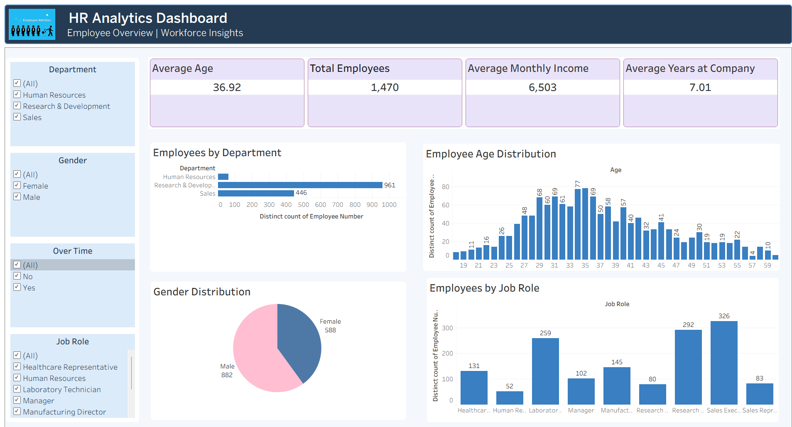
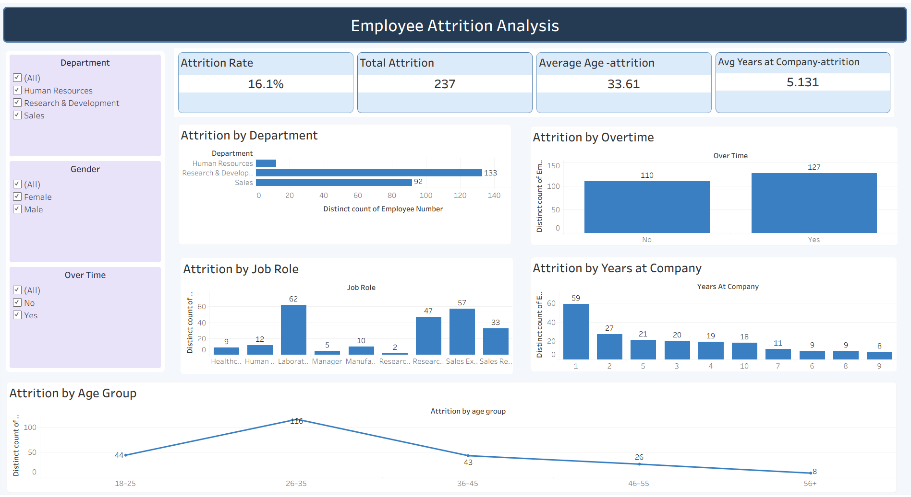
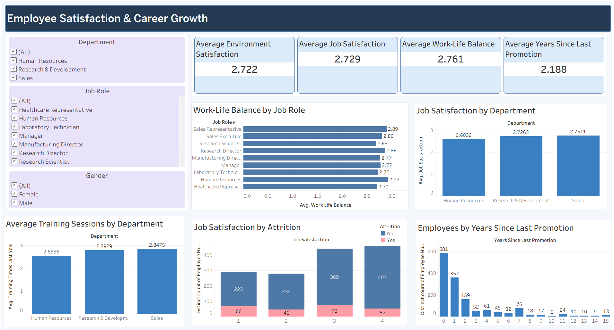

# HR Analytics – Employee Attrition Analysis

##  Project Overview

This project analyzes employee attrition to understand workforce trends and explore factors associated with employees leaving an organization. It examines employee demographics, departments, job roles, overtime, salary, job satisfaction, and career growth using data analysis and visualization tools.

##  Objectives

- Calculate the overall employee attrition rate.
- Compare attrition across departments and job roles.
- Explore attrition patterns by overtime and age.
- Analyze employee satisfaction and career growth.
- Present HR insights through interactive Tableau dashboards.

##  Tools & Technologies

- **Excel:** Data exploration, PivotTables, and charts
- **SQL (MySQL):** Data querying and analysis
- **Python (Pandas):** Data exploration and analysis
- **Tableau:** Interactive dashboards and data visualization

##  Project Workflow

1. Explored the HR dataset.
2. Analyzed employee data using Excel PivotTables and charts.
3. Performed SQL queries using MySQL.
4. Conducted data analysis using Python and Pandas.
5. Created interactive Tableau dashboards to present HR insights.

##  Tableau Dashboards

### 1. Employee Overview

Provides an overview of employee demographics, department distribution, age, gender, and job roles.

### 2. Employee Attrition Analysis

Explores employee attrition by department, job role, overtime, age, and years at the company.

### 3. Employee Satisfaction & Career Growth

Examines job satisfaction, environment satisfaction, work-life balance, training, and promotion-related metrics.

##  Key Analysis

- Overall employee attrition rate
- Department-wise and job-role-wise attrition
- Attrition by overtime status and age
- Average monthly income
- Job satisfaction and work-life balance
- Training and promotion-related patterns

##  Key Findings

- The overall employee attrition rate was approximately **16.12%**.
- **237 employees** had left the organization in the dataset.
- Research & Development had the highest attrition count among departments.
- Laboratory Technician had the highest attrition count among job roles.

##  Conclusion

This project demonstrates how Excel, SQL, Python, and Tableau can be used to analyze HR data, explore employee attrition patterns, and communicate findings through interactive visualizations.

